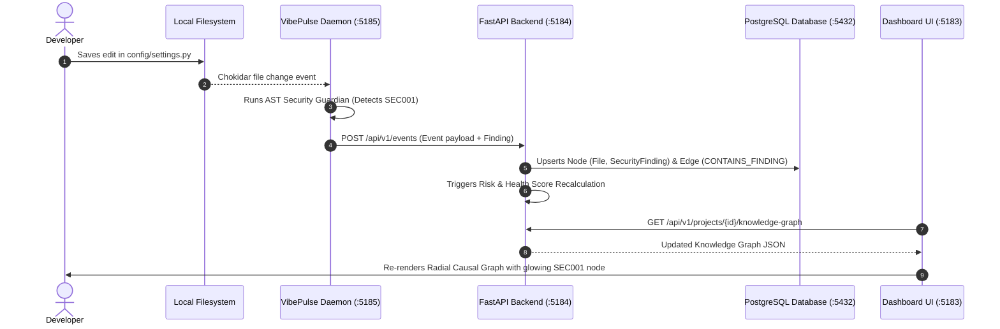

# 💻 VibePulse — Code Explanation & Architecture Overview

This document provides a clear, high-level walkthrough of the VibePulse codebase, its monorepo structure, component responsibilities, and how telemetry flows through the system.

---

## 🏛️ Monorepo Architecture Overview

VibePulse is structured as an enterprise-grade TypeScript & Python monorepo managed via `pnpm` workspaces and `turbo`:

```
VibeSync/
├── apps/
│   ├── api/                 # FastAPI (Python 3.12) Core Backend & Knowledge Graph Engine
│   ├── daemon/              # Node.js + TypeScript Real-Time Telemetry Watcher
│   └── dashboard/           # React 19 + Vite + Tailwind CSS Intelligence UI
├── packages/
│   ├── config/              # Shared Canonical Ports & Environment Schema
│   └── ui/                  # Shared React UI Component Library (Buttons, Badges, Cards)
├── docs/                    # Technical & Audit Documentation
└── scripts/                 # E2E Automation, Health Checks, and Demo Runbooks
```

---

## 🔧 Component Breakdown

### 1. `apps/api` (FastAPI Core Backend)

- **Role**: Serves the REST & SSE endpoints, manages PostgreSQL database operations via SQLAlchemy 2.0 async engine, runs graph traversal algorithms, and executes Bayesian predictive models.
- **Key Modules**:
  - `app/features/knowledge_graph/`: Serves `/api/v1/projects/{id}/knowledge-graph`, `/traversal/root-cause`, and `/traversal/impact`.
  - `app/features/investigation/`: Handles deep-link investigation evidence, finding correlation, and remediation status.
  - `app/features/telemetry/`: Ingests real-time events streamed from the daemon (`/events`).
  - `app/features/predictions/`: Calculates incident probability & health score impact using statistical models.

### 2. `apps/daemon` (Real-Time Node.js Watcher)

- **Role**: Watches target project directories using `chokidar`, performs instant AST parsing (via `@babel/parser` and regex AST Guardians), detects security anti-patterns (e.g. hardcoded secrets), and streams events to `apps/api`.
- **Key Files**:
  - `src/index.ts`: Daemon lifecycle manager & HTTP listener on port `5185`.
  - `src/watch-manager.ts`: Chokidar file watcher and event debouncer.
  - `src/publisher/http-publisher.ts`: Resilient queue-backed publisher streaming events to port `5184`.

### 3. `apps/dashboard` (React 19 Dashboard)

- **Role**: Provides the interactive single-page application for engineering intelligence.
- **Key Components**:
  - `src/pages/knowledge-graph/KnowledgeGraphPage.tsx`: Top header, mode selector (`General`, `Investigation`, `Impact`, `Memory`), depth picker (`1`, `2`, `3`, `All`), and view toggles (`Graph`, `Timeline`, `Before/After`).
  - `src/pages/knowledge-graph/CorrelationGraphCanvas.tsx`: Custom SVG graph engine rendering focused radial causal layout, bezier edges, cursor-centered zoom, drag-to-pan, and YouTube-like fullscreen.
  - `src/pages/knowledge-graph/CorrelationGraphInspector.tsx`: Streamlined 28% inspector panel displaying entity details, grounded evidence, risk points, and traversal triggers.

---

## 🔄 End-to-End Telemetry Flow


