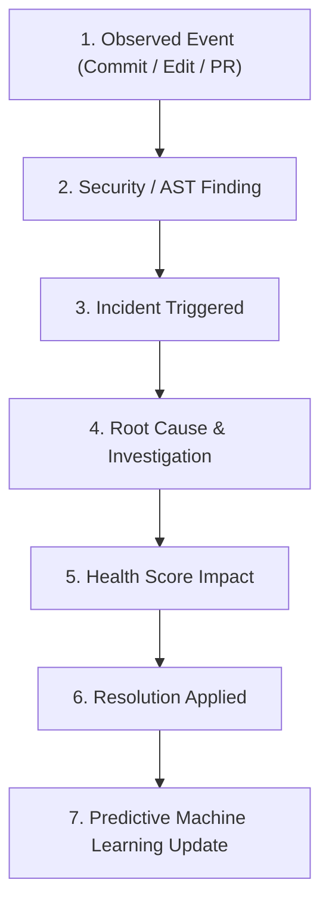

# 📖 VibePulse — Comprehensive Project Guide & User Manual

Welcome to the **VibePulse User Manual**. This document covers core concepts, entity relationships, graph navigation, root cause analysis, security remediation, and predictive risk management.

---

## 🧠 Core Concepts & Terminology

VibePulse is built on a 7-stage causal pipeline:

1. **Observed Event**: A concrete engineering activity (e.g., file modification in `config/settings.py`, Git commit `a8f19c`, or test execution).
2. **Finding**: A rule violation or vulnerability detected via static AST analysis or security inspection (e.g., `SEC001: Hardcoded AWS Credential`).
3. **Incident**: An aggregated operational or security incident linked to one or more high-severity findings that degraded repository health.
4. **Root Cause**: The verified causal origin of an incident (e.g., direct credential assignment during rapid debugging).
5. **Resolution**: The verified remediation step (e.g., `PR #104: Moved credentials to environment variables`).
6. **Health Impact**: Real-time project score delta (0–100) across 5 dimensions: Security, Code Quality, Delivery Velocity, Architecture, and Maintainability.
7. **Prediction**: Bayesian ML failure forecasting (e.g., 85% probability of credential leakage within next 3 sprints if unmitigated).

---

## 🗺️ Using the Correlation & Causality Graph

The **Correlation & Causality Graph** is the central command interface of VibePulse.

### 1. Focused Radial Causal Layout

- **Anchor Node (Center)**: The currently focused entity (e.g., `settings.py` or `SEC001`).
- **Left Column (Upstream Causes)**: Commits, file edits, and developer activities that led to this entity.
- **Right Column (Downstream Blast Radius)**: Resulting incidents, degraded health dimensions, and predicted future risks.
- **Top / Bottom (Lateral Context)**: Subsystems, technologies, and parent projects.

### 2. Interactive Navigation & Gestures

- **Cursor-Centered Zoom**: Scroll the mouse wheel or pinch on a trackpad to zoom in/out directly around your mouse pointer.
- **Pan Canvas**: Click & drag on empty space, or hold `Space` + drag from anywhere.
- **Center Node**: Click the Compass icon or press `C` to center on the selected node.
- **Auto-Fit**: Double-click empty canvas or press `0` / click `Fit Graph` to frame all visible entities with 80% viewport utilization.
- **Fullscreen Mode**: Click the Fullscreen button or press `F` (just like YouTube) to expand the canvas across the entire display. Press `Esc` or `F` to exit.

### 3. Progressive Depth Control

- **Depth 1**: Immediate 1-hop direct causes and impacts (cleanest focus, 5–8 nodes).
- **Depth 2**: 2-hop radius showing secondary cascading effects.
- **Depth 3**: 3-hop multi-system propagation.
- **Depth All (4)**: Complete project knowledge graph.

### 4. Mode Filtering

- **General**: Full entity topology.
- **Investigation**: Filtered specifically for incident response: Events $\to$ Findings $\to$ Incidents $\to$ Root Causes $\to$ Resolutions.
- **Impact**: Filtered for blast radius assessment: Files $\to$ Findings $\to$ Incidents $\to$ Health Dimensions $\to$ Predictions.
- **Memory**: Filtered for architectural memory: Subsystems, Frameworks, Files, and Tech stack.

---

## 🔍 Root Cause & Impact Traversal Steppers

When investigating an incident or vulnerability:

1. Select the node (e.g. `SEC001: Hardcoded Credential`).
2. Click **Trace Root Cause** in the right-hand Intelligence Inspector:
   - The canvas automatically dims unrelated nodes.
   - The causal path is highlighted in bright cyan with animated arrows.
   - The top banner provides **Prev / Next** step controls walking through: `Commit a8f19c` $\to$ `settings.py edit` $\to$ `SEC001 finding` $\to$ `INC01 incident`.
3. Click **Trace Impact** to walk downstream to see which health dimensions and predictions were affected.

---

## 🛡️ Security Command Center & Evidence Inspector

- Click **View Grounded Evidence** on any node to open the forensic modal.
- Inspect the exact raw file diff, rule metadata, CWE classification, risk point contribution (+15 pts), and provenance timestamp.
