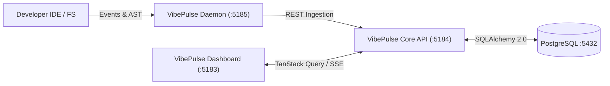

# 🚀 VibePulse — Real-Time Engineering Intelligence & Causality Platform

> **Track:** Developer Productivity, Security Intelligence, AI Engineering Observability  
> **Tagline:** Turning disconnected telemetry, code changes, and security findings into an actionable Correlation & Causality Graph.

---

## 🎯 What Problem Does VibePulse Solve?

Modern engineering teams suffer from **Cognitive Overload** and **Telemetry Fragmentation**:

- Git commits happen in isolation.
- Security scanners report hundred-line alert lists with no context on blast radius.
- CI/CD pipelines fail without clear upstream attribution.
- Post-mortems take days because tracing **Event $\to$ Finding $\to$ Incident $\to$ Root Cause $\to$ Impact** requires jumping across 5 different dashboards.

**VibePulse solves this by grounding every event in a Live Knowledge Graph.** It correlates developer activity, AST changes, security findings, health degradation, and predicted failures in real time.

---

## 🌟 Key Features

1. **Interactive Correlation & Causality Graph**:
   - Dynamic Radial Causal neighborhood layout (selected entity centered, upstream causes on the left, downstream blast radius on the right, context lateral).
   - Multi-hop depth expansion (Depth 1, 2, 3, and All).
   - YouTube-like Fullscreen Mode (`F` shortcut, double-click to auto-fit, cursor-centered zoom).
   - Root Cause & Impact Traversal steppers.
2. **Real-Time Daemon Watcher & Ingestion**:
   - Zero-lag AST diffing and local file telemetry watcher.
   - High-throughput REST & WebSocket event streaming to port `5184`.
3. **Security Command Center & AST Guardian**:
   - Instant detection of hardcoded secrets, dangerous sinks (`eval`, SQL injection), and risky dependencies.
   - Grounded evidence inspector with line-level file provenance.
4. **Predictive Failure Intelligence**:
   - Bayesian probability estimation predicting incident likelihood, security breach risk, and project health degradation.
5. **Interactive Chronological Timeline & Before/After Audit**:
   - Immutable timeline of engineering events.
   - Verified before-vs-after remediation comparison for compliance and audits.

---

## ⚡ Canonical Architecture & Ports



| Service         | Port                    | Description                                 |
| --------------- | ----------------------- | ------------------------------------------- |
| **Dashboard**   | `http://localhost:5183` | React 19, Vite, Tailwind CSS, Lucide Icons  |
| **Backend API** | `http://localhost:5184` | FastAPI, Python 3.12, Pyright, Graph Engine |
| **Daemon**      | `http://localhost:5185` | Node.js, TypeScript, Chokidar Watcher       |
| **Database**    | `localhost:5432`        | PostgreSQL 16 (Relational & Graph storage)  |

---

## 🚀 Quick Start in 60 Seconds

```bash
# 1. Install dependencies
pnpm install

# 2. Start PostgreSQL container
docker-compose up -d postgres

# 3. Launch full dev stack
pnpm dev

# 4. Open dashboard in your browser
# URL: http://localhost:5183/projects/334351d3-4aeb-4bc4-9387-f22e236acda8/knowledge-graph
```
