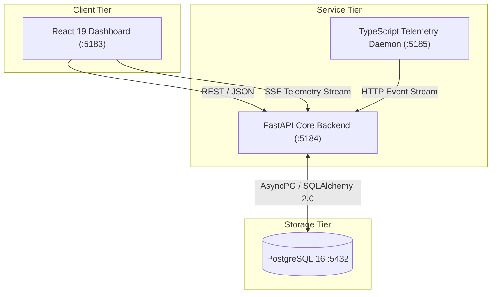

# 🏗️ 02. Technical Architecture & Component Design

This document details the system design, communication protocols, microservice boundaries, data models, and canonical port topologies of VibePulse.

---

## 🏛️ System Topology Diagram

---

## 🔌 Canonical Ports & Protocols

| Component          | Port   | Transport Protocol | Primary Responsibility                                   |
| ------------------ | ------ | ------------------ | -------------------------------------------------------- |
| **Dashboard**      | `5183` | HTTP / Vite HMR    | Graph UI, Inspector, Traversal Stepper, Evidence Modal   |
| **Backend API**    | `5184` | REST / SSE (JSON)  | Knowledge Graph Storage, Traversal Algorithms, ML Models |
| **Daemon Watcher** | `5185` | HTTP / FS Watcher  | Local Chokidar File Watcher, AST Security Guardian       |
| **PostgreSQL**     | `5432` | TCP (AsyncPG)      | Relational Storage for Nodes, Edges, Telemetry & Scores  |

---

## 🗄️ Database Schemas (Knowledge Graph Tables)

### `knowledge_graph_nodes`

- `node_id` (VARCHAR PK): Unique identifier e.g. `file-settings`, `sec-SEC001`, `incident-INC01`.
- `node_type` (VARCHAR): Enum (`Project`, `Subsystem`, `File`, `DevelopmentEvent`, `SecurityFinding`, `Incident`, `RootCause`, `Resolution`, `HealthDimension`, `Prediction`).
- `label` (VARCHAR): Human-readable display label.
- `subsystem` (VARCHAR, Nullable): Subsystem ownership (e.g. `Configuration`, `Authentication`).
- `metadata` (JSONB): Rich domain metadata (severity, risk points, evidence string, line numbers).
- `provenance` (VARCHAR): Data source (`OBSERVED`, `INFERRED`, `SIMULATED`).

### `knowledge_graph_edges`

- `relationship_id` (VARCHAR PK): Edge identifier e.g. `rel-1`.
- `source_node_id` (VARCHAR FK): Source node pointer.
- `target_node_id` (VARCHAR FK): Target node pointer.
- `relationship_type` (VARCHAR): Enum (`MODIFIED_FILE`, `CONTAINS_FINDING`, `CONTRIBUTED_TO`, `RESOLVED_BY`, `IMPACTS_METRIC`, `PREDICTS`).
- `reason` (TEXT): Grounded justification statement explaining why this connection exists.
- `evidence_references` (JSONB): List of grounded evidence IDs.
- `provenance` (VARCHAR): Data source (`OBSERVED`, `INFERRED`).
