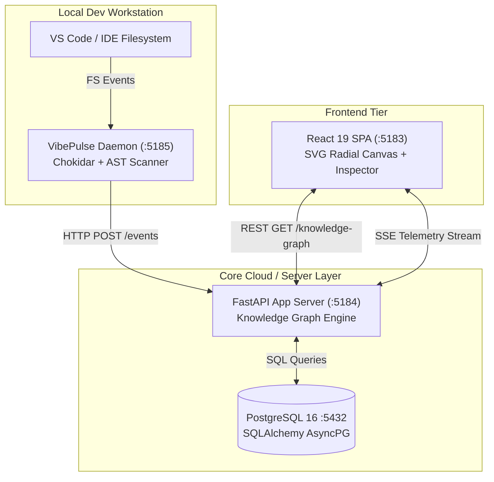
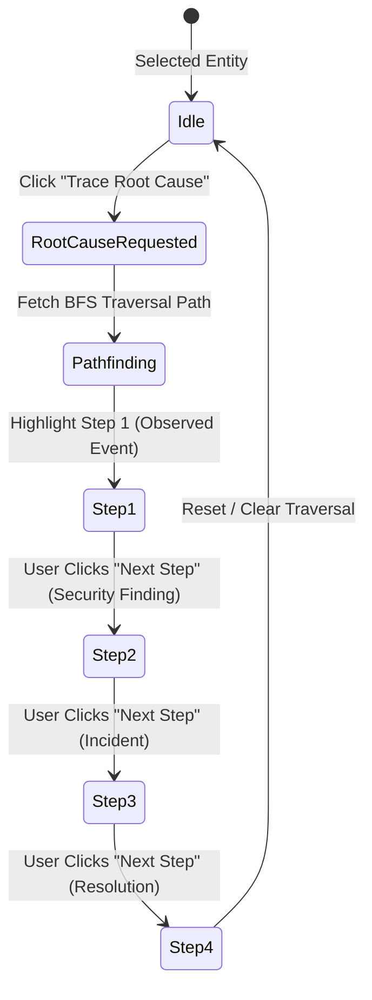
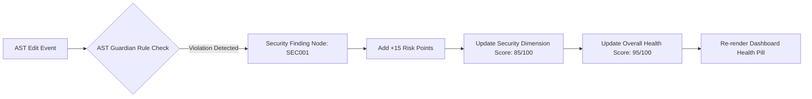

# 📐 05. System Design Diagrams & Data Flow Models

This document contains Mermaid diagrams illustrating system architecture, state machines, data flow, and graph traversal logic.

---

## 🗺️ 1. High-Level Component & Network Flow

---

## ⚡ 2. Root Cause Traversal State Machine

---

## 📊 3. Bayesian Risk & Health Calculation Flow

